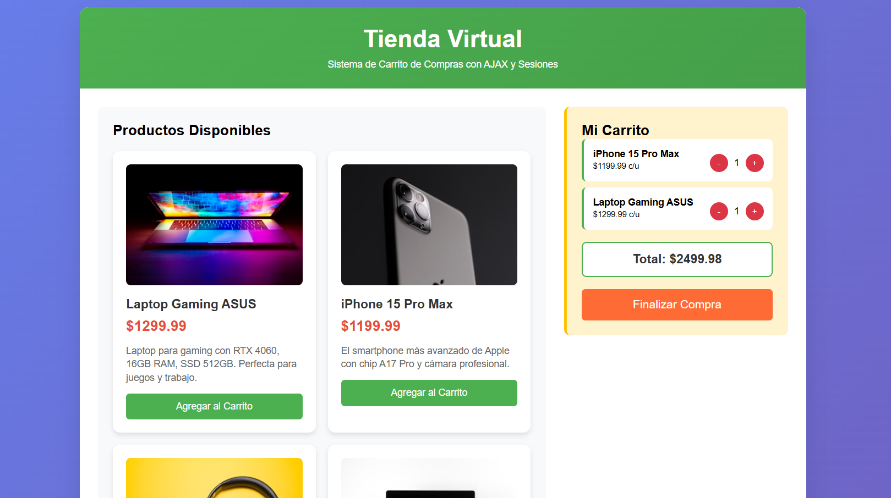

# AJAX Shopping Cart System - Guest Checkout

<p align="center">
  
</p>


**Author: Nicolas Cartin Reyes**

## Project Overview

This project implements a shopping cart using AJAX, PHP, and server-side sessions. It is optimized for guest checkout: there is no login, registration, or user authentication. Customers select products, provide their details during checkout, and the order is stored on the server.

## Main Features

### Requirements Demonstrated

The system demonstrates a practical shopping workflow with more than ten products, a persistent cart backed by PHP sessions, and a checkout form that collects the customer's name, email address, and phone number. The checkout action processes the order and stores the information on the server.

### Current Functionality

- **Guest checkout:** Registration and login are not required. Customers provide their name, email, and phone number at checkout.
- **Responsive design:** The interface adapts to desktop and mobile devices.
- **Real-time updates:** Cart actions and notifications use AJAX without full-page reloads.
- **Purchase history:** Purchase history can be stored on the server when enabled by the configuration.

## File Structure

```text
Shopping Cart/
├── index.html          # Main page with products and cart
├── productos.php       # API that returns the product list
├── carrito.php         # Cart operations
├── finalizar.php       # Final checkout processing
├── historial.html      # Purchase history page (optional)
├── historial.php       # Purchase history API (optional)
├── compras.json        # Generated purchase-history file
├── compras.txt         # Purchase data in text/CSV format
└── README.md           # Project documentation
```

## Technologies

The frontend uses HTML5 for structure, CSS3 for presentation, and vanilla JavaScript for AJAX behavior without external dependencies. The backend uses PHP and native session handling. PHP sessions provide temporary cart persistence, while JSON files provide permanent purchase-history storage. CSS Grid and Flexbox are used for the responsive layout.

## System Flow

### Main Page

The main page displays available products with images, names, prices, and descriptions. Customers can add products, change quantities, review the total, and open the checkout form.

### Product Management

Customers add products through the product controls. The action is sent to the server with AJAX, so the cart updates without reloading the page. Visual notifications confirm successful actions.

### Cart Management

Customers can review all cart items, change quantities, and remove products. The total is recalculated automatically after each change. When a product quantity reaches zero, that product is removed from the cart.

### Checkout

The checkout form requests the customer's name, email, and phone number. No authentication or registration is required. The order is stored in the purchase history and in a text/CSV file for administrative review.

### Purchase History

When enabled, the purchase-history page displays order details including products, quantities, prices, and dates.

## AJAX Implementation

### GET Requests

GET requests retrieve server data without changing it. They are used to load products from `productos.php` and retrieve the current cart state from `carrito.php`.

```javascript
// Load products
conexion.open('GET', 'productos.php');

// Get the current cart
conexion.open('GET', 'carrito.php?action=obtener');
```

### POST Requests

POST requests handle operations that change server data, including adding products, updating quantities, and completing checkout.

```javascript
// Add to cart
conexion.open('POST', 'carrito.php');
conexion.setRequestHeader('Content-type', 'application/x-www-form-urlencoded');
conexion.send('action=agregar&producto_id=1');
```

### Response Handling

The application checks the response status and parses the returned JSON so the interface can update dynamically without a full-page reload.

```javascript
conexion.onload = function() {
    if (conexion.status === 200) {
        const respuesta = JSON.parse(conexion.responseText);
        // Process a successful response
    } else {
        // Handle errors
    }
};
```

### Error Handling

The system handles connectivity and application errors. Connection failures display a user-facing notification and log details in the browser console for debugging.

```javascript
conexion.onerror = function() {
    mostrarNotificacion('Connection error', 'error');
};
```

## PHP Session Management

PHP sessions preserve the cart state between requests. Products remain in the user's session until checkout is completed.

```php
session_start();
if (!isset($_SESSION['carrito'])) {
    $_SESSION['carrito'] = [];
}
```

### Data Storage

When a customer adds a product, its name, price, and quantity are stored in the server session.

```php
$_SESSION['carrito'][$producto_id] = [
    'nombre' => $producto['nombre'],
    'precio' => $producto['precio'],
    'cantidad' => 1
];
```

### Calculations

The total-calculation function iterates over the session cart, multiplies price by quantity, and rounds the result to two decimal places.

```php
function calcularTotal() {
    $total = 0;
    foreach ($_SESSION['carrito'] as $item) {
        $total += $item['precio'] * $item['cantidad'];
    }
    return round($total, 2);
}
```

## Design and User Experience

The interface uses a coherent color system, subtle gradients, and shadows to provide depth without overwhelming the user. The responsive layout adapts from desktop screens to mobile devices. Notifications provide immediate feedback, loading indicators communicate AJAX activity, and clear labels support intuitive navigation.

The information panel updates the cart item count and purchase total in real time.

## Testing and Debugging

Important cart operations, session changes, and checkout events are logged in PHP. AJAX requests, URLs, request data, and responses are logged in the browser console to support troubleshooting.

## Project Strengths

This project demonstrates a complete guest-checkout flow with native web technologies. It combines AJAX, PHP sessions, JSON persistence, responsive design, structured error handling, and clear separation of responsibilities without relying on a framework.

---

## Author

This project was developed by **Nicolas Cartin Reyes** as a practical AJAX assignment focused on server-side sessions and guest checkout using AJAX, PHP, HTML5, CSS3, and vanilla JavaScript.
